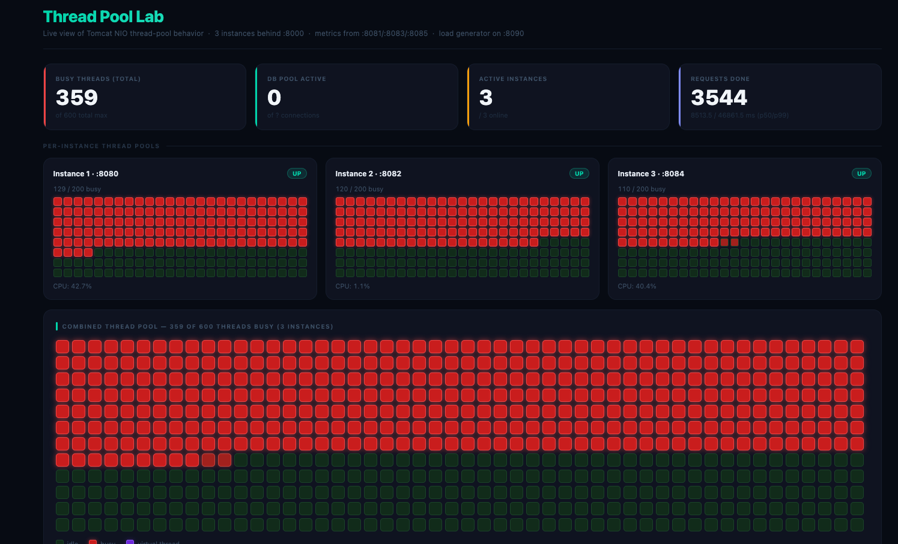
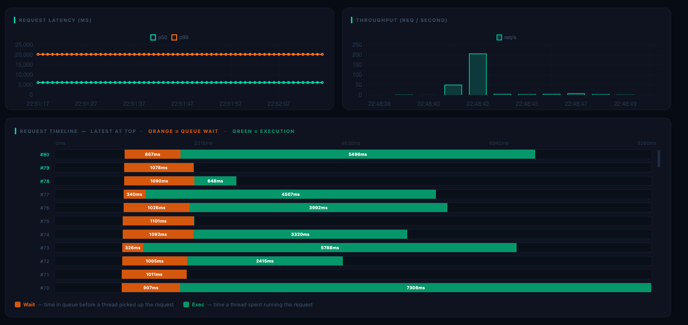
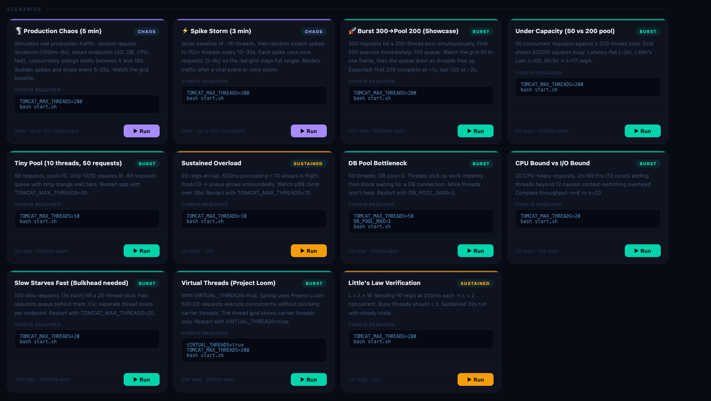

# Thread Pool Lab

> **Watch Tomcat's thread pool breathe in real time.**  
> See threads go busy, requests queue, latency grow, and secondary bottlenecks surface — all in a live dashboard.

   

---

## Demo

### Single Instance — Thread Pool Live View
https://github.com/suchithkumargm/study-materials/raw/main/spring%20boot/my%20practice%20codes/spring%20boot%20thread%20pool%20testing/media/Demo.mov

### Multi-Instance Cluster + Failover (700 concurrent, 2 instances killed mid-run)
https://github.com/suchithkumargm/study-materials/raw/main/spring%20boot/my%20practice%20codes/spring%20boot%20thread%20pool%20testing/media/multiple%20instances%20demo.mov





---

## What is this?

Thread Pool Lab is a visual, hands-on playground for understanding how web servers handle concurrent traffic. It runs a real Spring Boot app, fires configurable load at it, and shows you — in real time — exactly what the thread pool is doing.

**Key things you can observe:**
- Which threads are idle vs busy (the grid)
- How long each request waited in the queue before a thread picked it up
- What happens to p99 latency when the pool saturates
- How DB connection pool limits can bottleneck you even when threads are free
- The difference between CPU-bound and I/O-bound concurrency
- Project Loom virtual threads vs platform threads

---

---

## Architecture

```
Browser (http://localhost:3001)
   │
   ├── polls :8081 / :8083 / :8085 ───► Spring Boot management servers (per instance)
   │   (actuator/lab endpoint)           Separate thread pool per instance — stays live
   │                                     even when the app port is fully saturated
   │
   └── POSTs :8090 ────────────────────► Python load generator (FastAPI)
                                          fires requests at :8000 (proxy)
                                          records wait_ms + exec_ms + instance per req
                                               │
                                               ▼
                                    Python round-robin proxy :8000 (FastAPI + httpx)
                                    Retries next backend on ConnectError (failover)
                                         │           │           │
                                         ▼           ▼           ▼
                                    Instance 1   Instance 2   Instance 3
                                      :8080        :8082        :8084
                                    Tomcat NIO   Tomcat NIO   Tomcat NIO
                                    (200 threads)(200 threads)(200 threads)
                                         │           │           │
                                         └─────────────────────┘
                                                     │
                                                     ▼
                                              MySQL :3306 (Docker)
                                              HikariCP (configurable)
```

**Why separate management ports?**  
When an app port is fully saturated (all 200 threads busy), its management port (`:8081`/`:8083`/`:8085`) stays responsive — Spring Boot gives each a separate thread pool. The dashboard polls all three management ports so metrics keep flowing at exactly the moment things get interesting.

**Why a Python proxy instead of nginx?**  
Zero extra dependencies. The proxy adds retry logic: on `ConnectError` (dead backend) it advances the round-robin cycle and tries the next instance — so requests transparently reroute after a kill.

---

## Project Structure

```
thread-pool-testing/
├── app/                          # Spring Boot app (Java 21, Maven)
│   └── src/main/java/com/threadpoollab/
│       ├── controller/
│       │   ├── WorkloadController.java   # /api/* workload endpoints
│       │   └── MetricsController.java   # /metrics/snapshot (CORS-safe fallback)
│       ├── service/
│       │   └── MetricsService.java      # thread/DB/CPU metrics snapshot
│       ├── filter/
│       │   └── TimingFilter.java        # X-Wait-Ms, X-Exec-Ms headers
│       └── actuator/
│           └── LabEndpoint.java         # /actuator/lab custom endpoint
├── proxy/
│   └── proxy.py                  # Round-robin reverse proxy (:8000) with failover
├── dashboard/
│   └── index.html                # Single-file live dashboard (served on :3001)
├── load-generator/
│   └── load_gen.py               # FastAPI load generator (:8090), 14 scenarios
├── start.sh                      # Start all 3 instances + proxy + load-gen + dashboard
├── stop.sh                       # Stop everything (MySQL container left running)
├── docker-compose.yml            # (MySQL expected in existing Docker container)
└── media/                        # Screenshots and demo recordings
    ├── Demo.mov
    ├── multiple instances demo.mov
    └── img*.png
```

---

## Quick Start

### Prerequisites
- Java 21+ (`/usr/libexec/java_home -v 25` or set `JAVA_HOME`)
- Maven 3.9+
- MySQL running in Docker — the app expects a container named `crud-mysql` on port 3306 with user `root` / password `root`
- Python 3.10+ with `fastapi`, `uvicorn`, `httpx`

```bash
pip install fastapi uvicorn httpx
```

### Start

```bash
# Build once
cd app && mvn package -DskipTests && cd ..

# Start everything:
#   3 Spring Boot instances  (:8080 / :8082 / :8084, management :8081 / :8083 / :8085)
#   Round-robin proxy        (:8000)
#   Load generator           (:8090)
#   Dashboard HTTP server    (:3001)
bash start.sh

# Open the dashboard
open http://localhost:3001
```

### Pick a scenario and click **▶ Run**

The **Cluster Chaos + Failover** and **Production Chaos** scenarios at the top are the best starting point — they simulate realistic, unpredictable cluster-level traffic with instance failures.

### Stop

```bash
bash stop.sh
```

---

## Configuration

All options are environment variables — restart the app to apply:

| Variable | Default | What it controls |
|---|---|---|
| `TOMCAT_MAX_THREADS` | `200` | Maximum Tomcat worker threads |
| `TOMCAT_MIN_THREADS` | `10` | Min spare threads (warm pool size) |
| `TOMCAT_ACCEPT_COUNT` | `100` | TCP backlog queue beyond max threads |
| `DB_POOL_MAX` | `10` | HikariCP max connections |
| `DB_POOL_MIN` | `2` | HikariCP min idle connections |
| `VIRTUAL_THREADS` | `false` | Enable Project Loom virtual threads |

```bash
# Example — tiny pool to observe queuing clearly
TOMCAT_MAX_THREADS=10 bash start.sh
```

---

## Workload Endpoints

| Endpoint | Simulates | Key params |
|---|---|---|
| `GET /api/fast` | Instant (no I/O) | — |
| `GET /api/io?ms=500` | I/O wait (Thread.sleep) | `ms` — sleep duration |
| `GET /api/cpu?iterations=100000000` | CPU-bound spin | `iterations` |
| `GET /api/db?rows=100` | DB query (MySQL INFORMATION_SCHEMA scan) | `rows` |
| `GET /api/db-sleep?ms=300` | DB I/O wait (MySQL SLEEP function) | `ms` |
| `GET /api/slow?ms=3000` | Slow upstream dependency | `ms` |
| `GET /api/warmup` | JVM warmup (50ms sleep × 1) | — |

**Per-request timing headers** (set by `TimingFilter`):

| Header | Value |
|---|---|
| `X-Thread-Name` | Which Tomcat thread handled this request |
| `X-Wait-Ms` | Time from client send → thread picked it up (queue wait) |
| `X-Exec-Ms` | Time the thread spent executing |
| `X-Thread-Start` | Thread start timestamp (ms) |
| `X-Complete-At` | Response completion timestamp (ms) |

---

## Dashboard Panels

| Panel | What it shows |
|---|---|
| **Instance Cards** | Per-instance UP/DOWN badge, mini thread grid, CPU %, busy thread count. Updates every 500ms. |
| **Combined Thread Grid** | All 3 instances combined (up to 600 squares). 🟥 Red = busy, 🟩 Green = idle. |
| **Stat Cards** | Total busy threads across cluster, active instances (X/3), DB pool, requests done |
| **DB Pool Bar** | HikariCP active / idle / pending connections at a glance |
| **Latency Chart** | Rolling p50 and p99 over the last 60s |
| **Throughput Chart** | Requests completed per second |
| **Request Timeline** | Latest requests at top, scrollable. Orange bar = queue wait, green bar = execution. Instance tag per row. |
| **Little's Law Calculator** | Enter λ (req/s) and W (ms) → predicts L (concurrent). Compare to actual busy threads. |
| **Scenario Panel** | Click ▶ Run on any scenario. Shows mode, required config, and description. |

---

## Scenarios

### 🌪️ Cluster Chaos + Failover *(30s — great for recording)*
Ramps to 700 concurrent across all 3 instances (maxing out all 600 Tomcat threads). At t=10s Instance 2 is killed — watch the proxy reroute live requests. At t=20s Instance 3 is killed — only Instance 1 survives with the full load.

**What to watch:** Two instance cards flip to DOWN mid-run. The surviving thread grid turns solid red. Request timeline shows uninterrupted flow as the proxy retries dead backends. p99 spikes briefly then stabilises.

---

### 🌪️ Production Chaos *(5 min)*
Random request durations (100ms–8s), mixed endpoints (I/O, DB, CPU, fast), concurrency swings between 5 and 550. Sudden spikes and drops every 5–25 seconds across all 3 instances.

**What to watch:** All three thread grids breathe unpredictably. p99 spikes when slow requests pile up. Throughput chart shows irregular waves.

---

### ⚡ Spike Storm *(3 min)*
Quiet baseline of ~10 threads, then violent spikes to 500 threads every 10–30s with slow requests (2–8s) — simulating a retry storm or viral traffic event.

**What to watch:** Grids go from nearly empty to full red in one second. Orange wait bars appear in the timeline during spikes as queues fill.

---

### ⚖️ Load Balancer Distribution
300 concurrent requests via the round-robin proxy. Each instance should handle ~100 (33%).

**What to watch:** All 3 mini thread grids fill equally. Instance card counters balance. Shows even distribution working correctly.

---

### 🔥 Cluster Overload (600 req)
600 simultaneous requests against a 3×200 thread cluster — all 600 slots fill instantly.

**What to watch:** All 600 squares in the combined grid go red simultaneously. Kill one instance mid-run to watch the other two compensate.

---

### 🚀 Burst 300 → Pool 200
300 requests hit simultaneously. First 200 get threads; 100 queue.

**What to watch:** Grid fills all 200 red squares in the first frame. Timeline shows 100 requests with large orange wait bars. p50 roughly doubles due to queuing.

---

### Under Capacity
50 requests against a 200-thread pool.

**What to watch:** Only 50/200 squares go red. Zero queue. Latency stays flat. Little's Law: L = λ × W = 50.

---

### Tiny Pool *(requires restart with `TOMCAT_MAX_THREADS=10`)*
50 requests, only 10 threads.

**What to watch:** Grid fills 10/10 immediately. 40 requests stack up with long orange wait bars. Requests complete in batches of 10.

---

### Sustained Overload *(requires restart with `TOMCAT_MAX_THREADS=10`)*
20 req/s arrival rate with 500ms processing. Little's Law predicts 10 always in flight — exactly the pool size.

**What to watch:** Every thread slot stays full. p99 climbs linearly as queue grows. Classic overload pattern.

---

### DB Pool Bottleneck *(requires restart with `TOMCAT_MAX_THREADS=50 DB_POOL_MAX=3`)*
50 HTTP threads but only 3 DB connections.

**What to watch:** Thread grid goes busy, then threads stall waiting for a DB connection. Adding more threads (`TOMCAT_MAX_THREADS=100`) makes no difference — DB pool is the real bottleneck.

---

### CPU Bound vs I/O Bound
20 CPU-heavy requests (spin loop).

**What to watch:** On a 12-core machine, throughput plateaus after 12 concurrent threads. Threads 13–20 add context-switching overhead. Compare to `/api/io` at the same concurrency — I/O scales linearly, CPU does not.

---

### Slow Starves Fast *(requires restart with `TOMCAT_MAX_THREADS=20`)*
100 slow (3s) requests fill all 20 threads.

**What to watch:** Hit `/api/fast` manually while this runs — it queues behind the slow requests for 3+ seconds. This is the **thread starvation** pattern. Fix: bulkhead (separate thread pools per endpoint type).

---

### Virtual Threads — Project Loom *(requires restart with `VIRTUAL_THREADS=true`)*
500 I/O requests with Project Loom enabled.

**What to watch:** The grid shows carrier (platform) threads, not virtual threads. Far fewer carrier threads stay busy while hundreds of virtual threads handle requests concurrently. JVM thread count in grid title shows live carrier count.

---

### Little's Law Verification
10 req/s × 200ms processing = L = 2 concurrent requests predicted.

**What to watch:** Busy threads gauge during the 30s run should hover around 2. Use the dashboard calculator: enter λ=10, W=200 → L=2.

---

## Run Scenarios from CLI

```bash
# Fire a scenario
curl -X POST http://localhost:8090/run/cluster-chaos
curl -X POST http://localhost:8090/run/production-chaos
curl -X POST http://localhost:8090/run/burst-showcase

# Watch live status
watch -n1 'curl -s http://localhost:8090/status'

# Get full results (p50, p99, per-instance counts, per-request breakdown)
curl -s http://localhost:8090/results | python3 -m json.tool

# Stop the current run
curl -X POST http://localhost:8090/stop

# Check proxy routing counts
curl -s http://localhost:8000/proxy/status | python3 -m json.tool

# Check which backends are alive
curl -s http://localhost:8000/proxy/health | python3 -m json.tool

# Check live metrics per instance
curl -s http://localhost:8081/actuator/lab | python3 -m json.tool  # Instance 1
curl -s http://localhost:8083/actuator/lab | python3 -m json.tool  # Instance 2
curl -s http://localhost:8085/actuator/lab | python3 -m json.tool  # Instance 3
```

---

## Honest Observations

**Lazy thread creation**  
Tomcat doesn't pre-create `max_threads` threads at startup. With `min-spare=10`, only 10 threads exist initially. During a burst, the pool grows lazily — which means even "early" requests have a small queue wait while new threads are being created.

**exec_ms accuracy**  
`TimingFilter` wraps the response in `ContentCachingResponseWrapper` and writes timing headers *after* `chain.doFilter()` completes. Without this, headers set in a `finally` block after the response is committed return `0`.

**threads_busy source**  
`tomcat.threads.busy` from Micrometer is unavailable when `management.server.port` differs from `server.port` (a Spring Boot 3.x limitation). `MetricsService` uses `http.server.requests.active` (a `LongTaskTimer`) instead — its `activeTasks()` count correctly equals the number of Tomcat threads currently executing an HTTP request.

**httpx connection limit**  
Python's `httpx.AsyncClient` defaults to 100 connections per host. Both the load generator and the proxy set `Limits(max_connections=800, max_keepalive_connections=400)` to support up to 700 concurrent in-flight requests without connection exhaustion.

**Proxy failover**  
The round-robin proxy retries up to `len(BACKENDS)` times on `ConnectError` or `RemoteProtocolError`. In-flight requests that were already routed to a killed instance fail (the OS closes the TCP connection abruptly); only new requests after the kill reroute transparently. This matches real load balancer behavior.

---

## Tech Stack

| Component | Tech |
|---|---|
| Web server | Spring Boot 3.3.5, Tomcat NIO connector (3 instances) |
| Metrics | Micrometer, Spring Actuator (`/actuator/lab` per instance) |
| Database | MySQL 8, Spring Data JPA, HikariCP |
| Proxy | Python 3, FastAPI, httpx — round-robin + failover retry |
| Load generator | Python 3, FastAPI, httpx async — 14 scenarios, 800-conn pool |
| Dashboard | Vanilla JS, Chart.js 4.4 — polls all 3 management ports |

---

## License

MIT
